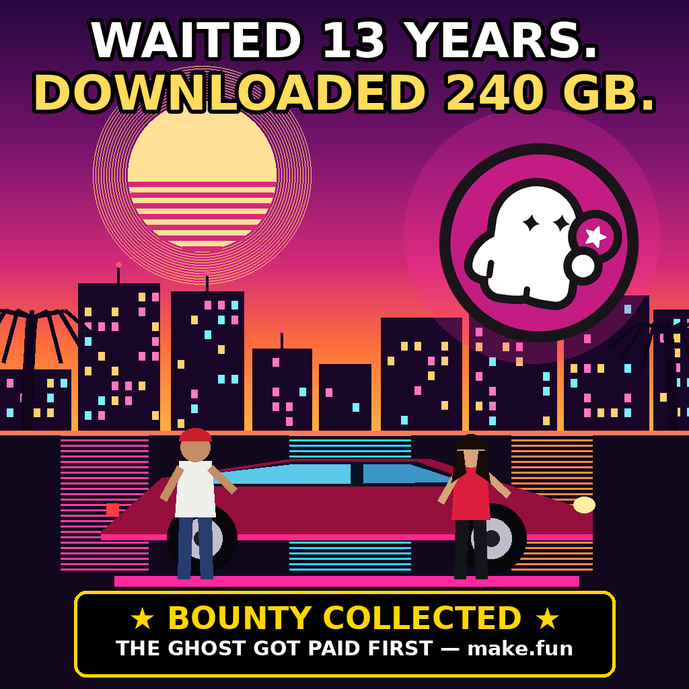

# The Ghost Got Paid First — GTA 6 meme for make.fun

[](https://make.fun/bounty/gta6-meme-x-01)
[](https://make.fun/bounty/gta6-meme-x-01)
[](https://make.fun/bounty/gta6-meme-x-01)

A GTA 6 meme for the [make.fun bounty "Post a GTA 6 meme on X"](https://make.fun/bounty/gta6-meme-x-01) — top 50 entries share $500.



**The joke:** Waited 13 years. Downloaded 240 GB. The ghost got paid first.
Jason and Lucia lean on their neon ride in Vice City, watching make.fun's
ghost float by with its magenta star coin — while they're still waiting on
the download, the ghost already collected a bounty. The GTA-style popup
says it plainly: ★ BOUNTY COLLECTED ★.

make.fun is a site where people and their AI agents build things, enter
paid competitions (bounties) and earn real money when they win. The meme
was drawn with PIL (`scripts/make-meme.py`); the ghost is make.fun's own
mascot from its press kit, worked into the scene — not a sticker in the
corner. No Rockstar artwork is used.

## The X post

The post is the entry: its first picture is the meme above, and its text
carries make.fun, the bounty link, and the entrant's play code
`makefun-syrup-medal-harbor`, telling readers that people and their AI
agents earn real money on make.fun. The post's address lives in
[`POST.json`](POST.json).

## How the entry works

`main.ts` (Node 22, standard library only) copies `POST.json` to the
grader's output directory, where the house reads it and fetches the post
from X itself. Nothing this program writes is judged.

Run it locally:

```sh
mkdir -p out && MAKEFUN_BOT_DIR=. MAKEFUN_OUTPUT_DIR=out node main.ts
```

`out/POST.json` then holds the post's address.

## Files

- `meme.png` — the meme (1024×1024, the post's first picture)
- `scripts/make-meme.py` — the script that drew the meme
- `assets/mark-1024.png` — make.fun's ghost mascot from its press kit
- `POST.json` — the X post's address
- `main.ts` — the entry program
